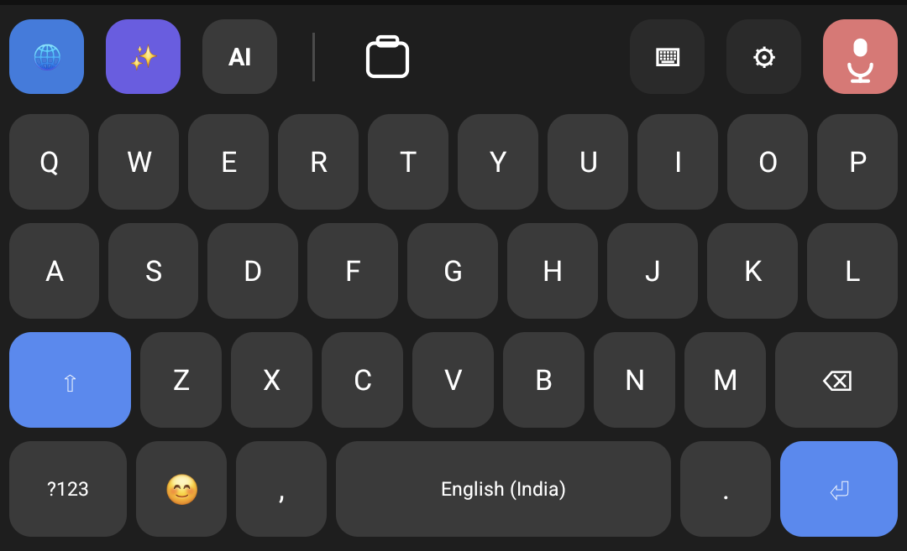
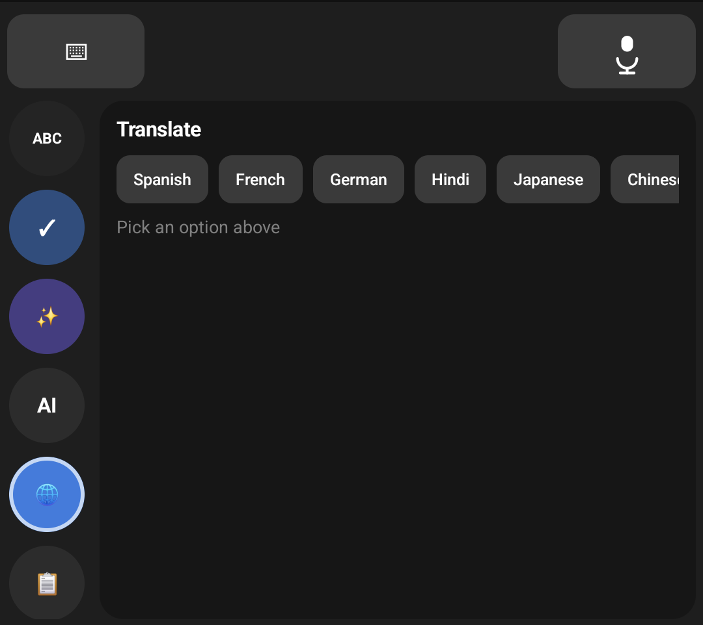

# Type Assist — AI-Powered Android Keyboard

Type Assist is a custom Android keyboard (an Input Method Editor, or IME) that brings AI writing tools directly into the keyboard, so they work inside **any app**: WhatsApp, Gmail, Instagram, Chrome, Notes, and so on. Instead of copying text into a separate AI app and pasting it back, the user taps a button on the keyboard and the text in the field is fixed, rewritten, or translated in place.

## Screenshots

| Keyboard | Translate panel |
|---|---|
|  |  |


---

## What it does

### AI writing tools (powered by Llama 3.3 70B via the Groq API)
| Feature | What happens |
|---|---|
| **Fix Grammar** | One tap corrects grammar, spelling, and punctuation and replaces the text in the field. |
| **Change Tone** | Rewrites the text in 13 preset tones (Professional, Casual, Polite, Funny, Empathetic, Gen-Z, Witty, …) or any custom tone the user types. |
| **Translate** | Translates the text into 12 languages (Spanish, French, German, Hindi, Japanese, Chinese, Arabic, …). |
| **Smart Reply** | Reads a received message and suggests three replies: positive, neutral, and declining. |
| **Summarize / Humanize / Emojify / Caption** | Shortens text, makes AI-sounding text read naturally, adds emojis, or turns text into a social-media caption with hashtags. |
| **Custom Prompt** | The user types any instruction ("make this a bullet list") and the AI applies it to the text. |

AI results are shown as preview cards first; the user taps one to apply it, so nothing is replaced without consent.

### Core keyboard
- Full QWERTY and symbol layouts, built from scratch in **Jetpack Compose**.
- **Smart shift:** one tap capitalizes a single letter, a double tap turns on caps lock, and the keyboard auto-capitalizes at the start of sentences (respecting each text field's own capitalization settings).
- **Context-aware Enter key:** shows and performs the action the app asks for (Send, Search, Go, Next, Done).
- **Hold-to-repeat backspace** that speeds up the longer it is held, and handles emoji correctly (no half-deleted characters).
- **Word suggestions** that learn from the user's own typing, stored only on the device.
- **Voice typing** using Android's speech recognizer, with an in-keyboard microphone permission flow.

### Media and productivity
- **Emoji panel** with categories and a "Recent" tab.
- **GIF search** (Giphy trending) and **custom stickers** saved from the clipboard, sent straight into chat apps using Android's rich-content API (the same mechanism Gboard uses).
- **Clipboard history:** quickly re-paste recently copied text.

### Personalization
- 6 colour themes (Dark, Light, Midnight, Forest, Sunset, Mono), a custom **background photo**, 4 fonts, and 3 text sizes, all changeable from a settings screen.

### Privacy
- **Typing history is encrypted on the device** with AES-256-GCM (AndroidX Security `EncryptedFile`) and is never uploaded.
- **Password fields are detected and excluded**: no suggestions, no learning, no history.
- Only the text the user explicitly sends to an AI action leaves the device.

---

## Tech stack

| Area | Technology |
|---|---|
| Keyboard engine & UI | **Kotlin**, Android `InputMethodService`, **Jetpack Compose** (Material 3) |
| Onboarding app | **React Native 0.86** with **TypeScript** |
| AI | **Groq API** (OpenAI-compatible chat completions), model `llama-3.3-70b-versatile` |
| Networking & async | **OkHttp**, **Kotlin Coroutines** |
| Media | **Coil** (image + GIF loading), **Giphy API**, `FileProvider` + `InputConnectionCompat.commitContent` |
| Storage & security | AndroidX Security Crypto (AES-256-GCM), on-device files |
| Speech | Android `SpeechRecognizer` wrapped in a Kotlin `callbackFlow` |
| Target | Android 7.0+ (minSdk 24), targetSdk 36 |

---

## Architecture

```
app/
├── App.tsx                         React Native onboarding screen: feature showcase,
│                                   "enable keyboard" steps, links to settings/history
└── android/app/src/main/java/com/aikeyboard/assistant/
    ├── ime/
    │   ├── KeyboardService.kt      The IME itself: hosts the Compose UI, talks to the text
    │   │                           field (InputConnection), handles keys, suggestions,
    │   │                           auto-caps, voice, GIF/sticker insertion
    │   ├── KeyboardScreen.kt       All keyboard UI: key rows, AI panels, emoji/GIF panels,
    │   │                           shift/caps state, toolbar state machine
    │   ├── GroqClient.kt           AI API client
    │   ├── AiAction.kt             AI actions and their prompts
    │   ├── WordSuggester.kt        On-device word-frequency learning and suggestions
    │   ├── TypingHistoryStore.kt   Encrypted per-day typing history
    │   ├── SpeechInputHelper.kt    Voice input as a coroutine Flow
    │   ├── GiphyClient.kt, StickerStore.kt, ClipboardHistoryStore.kt,
    │   │   RecentEmojiStore.kt, EmojiData.kt
    │   └── KeyboardTheme.kt        Themes, fonts, sizes, and their persistence
    ├── KeyboardSettingsActivity.kt Theme / font / background settings screen
    ├── TypingHistoryActivity.kt    View or clear encrypted history
    └── RequestMicPermissionActivity.kt
```

### Interesting engineering problems solved
- **Running Jetpack Compose inside a keyboard service.** Compose normally expects to live in an Activity. The keyboard service implements `LifecycleOwner`, `ViewModelStoreOwner`, and `SavedStateRegistryOwner` itself and attaches them to the keyboard window, or Compose crashes the first time the keyboard opens.
- **Keys becoming untouchable after screen rotation.** Diagnosed a stale touch region left behind when the keyboard window resizes, and fixed it by forcing the window to re-register its touch area and rebuilding the key layout on rotation.
- **Responsive key sizing.** Key height is calculated from both screen width and screen height, so the keyboard never covers more than 55% of the screen in landscape or on short devices.
- **Keeping typing fast.** Word learning and encrypted history writes run on a single background thread (`Dispatchers.IO.limitedParallelism(1)`), so keystrokes never wait on disk I/O and writes never race each other.
- **Emoji-safe deletion.** Backspace detects UTF-16 surrogate pairs, so one press deletes a whole emoji instead of leaving a broken half-character.

---

## Running it locally

**Requirements:** Node 22+, JDK 17, Android SDK, and an Android phone or emulator.

1. Install dependencies:
   ```sh
   npm install
   ```
2. Add your API keys to `android/local.properties` (this file is git-ignored; never commit it):
   ```properties
   GROQ_API_KEY=your_groq_key
   GIPHY_API_KEY=your_giphy_key
   ```
3. Build and install on a connected phone:
   ```sh
   npm run android
   ```
4. On the phone, open **Type Assist** → **Open Keyboard Settings** → turn on **Type Assist**, then switch to it from any text field.

---
